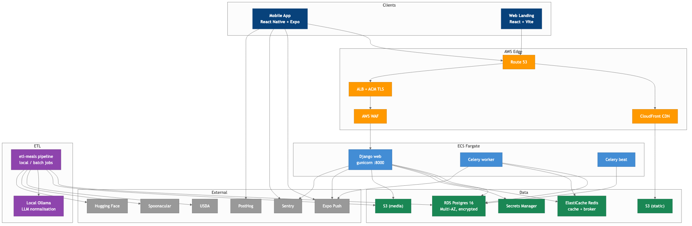

# MealPilot: intelligent meal planning for households

MealPilot generates weekly meal plans for households under budget, allergy, religious, cooking-time and nutrition constraints, using local Kazakhstani recipes and prices. It is the bachelor's thesis project *Design and Implementation of a Web Application for Intelligent Meal Planning with Local Cuisine Integration* (School of Software Engineering, Astana IT University, 2026). The thesis PDF and its LaTeX sources are in [`docs/diploma/`](docs/diploma/) ([`main.pdf`](docs/diploma/main.pdf)).

Development happened in separate repositories (backend, frontend, mobile, infrastructure, docs); this repository is the consolidated version prepared for publication.

## Problem

A household planning a week of meals is not picking recipes by taste alone. The plan has to respect a shared budget, each member's allergies, religious and dietary bans, the time available for cooking and how much repetition people accept, while meeting calorie and macronutrient targets for several people with different goals. Existing tools mostly log calories or recommend single recipes. They rarely model the household as a whole, use local cuisine and local prices, or explain why a plan was chosen. MealPilot targets households of one to ten members in Kazakhstan: Russian-language recipes, prices in KZT, and an explanation attached to every plan.

## Approach

Plan generation is a pipeline (thesis, Chapters 2 and 3):

1. **Data layer (offline ETL).** A Russian-language recipe corpus of about 93k recipes from Hugging Face (`ru_recipes_93k`) plus supplementary sources is normalised to canonical ingredients. Sentence-transformer embeddings with k-means bootstrap ingredient alias clusters, which are reviewed before promotion. MinHash LSH over ingredient sets detects near-duplicate recipes, and an eight-component quality score gates what the planner may use. About 90k recipes remain. Nutrition comes from a USDA FoodData Central catalog (107 ingredient entries); prices come from official Kazakhstani statistics on socially significant goods (20 cities) and an Arbuz.kz retail snapshot. The ETL pipeline lives in a separate private repository and is described in Chapter 2 of the thesis.
2. **Rule-based candidate filtering.** The planner keeps published recipes of the requested meal types above a quality threshold and drops pseudo-recipes (tea, dough, sauces, marinades). It then checks each recipe against the members' allergies, intolerances, religious and dietary bans and dislikes (by ingredient, tag or free text), and against the household's budget and cooking-time strictness.
3. **Scoring.** A deterministic preference score in [0, 0.99] combines local cuisine, member goals, the chosen optimisation focus, cooking-time fit and budget proximity. A LightGBM LambdaRank ranker with a graceful fallback is implemented next to it (see the note under [Results](#results)).
4. **Assignment with OR-Tools CP-SAT.** Binary variables assign recipes from a top-20-per-category shortlist to (day, meal slot) cells. Constraints: exactly one recipe per slot, repetition caps, no back-to-back repeats, a budget cap, and slack variables for calorie, protein, fat and carbohydrate shortfall and overshoot. The objective trades off score, diversity, repetition, cost and macro fit, weighted by the user's optimisation focus. The solver gets a 5 s wall-clock budget and 8 workers. If it returns neither OPTIMAL nor FEASIBLE, a greedy deterministic planner runs instead.
5. **Post-processing.** Serving suggestions per slot, an aggregated shopping list (optionally pantry-aware), human-readable plan explanations, and budget and nutrition analytics.

Plan generation runs asynchronously. The API records a `PlanGenerationRun`, a Celery worker on the `planning` queue runs the pipeline, the client polls the run, and an Expo push notification announces the result.

## Architecture



| Layer | Stack |
|---|---|
| Backend | Django 5.1 + Django REST Framework, Celery (worker + beat), PostgreSQL 16, Redis 7, Gunicorn; OpenAPI schema via drf-spectacular |
| Planner | OR-Tools CP-SAT, deterministic scorer and greedy fallback; LightGBM ranker package (`ml_scoring`) |
| Mobile | React Native + Expo (managed workflow), React Navigation, TanStack Query, React Hook Form; 27 screens |
| Web | React + Vite + TypeScript: landing page and a minimal dashboard on the same API |
| Infrastructure | Terraform, 14 modules: ECS Fargate (web, worker, beat), RDS PostgreSQL Multi-AZ, ElastiCache Redis, ALB + ACM + WAF, CloudFront + S3, Secrets Manager, Route 53, CloudWatch alarms, GitHub OIDC |
| Delivery | 8 GitHub Actions workflows (backend CI and deploy, ETL CI, mobile CI, EAS build and update, Terraform plan and apply) |
| Operations | 5 runbooks, 5 Architecture Decision Records, C4 model (levels 1-3), CloudWatch dashboard definitions, Sentry and PostHog with no-op fallbacks |

The production environment is fully composed in Terraform (`dev` and `staging` hold only remote-state configuration). A test deployment ran on an AWS server during the thesis work and was later shut down to save costs; the full Terraform production stack is deployment-ready, as the thesis describes.

### Repository layout

```
backend/              Django + DRF API, Celery tasks, planner and ranker
  apps/planning/      plan generation (services.py), Celery tasks, ml_scoring/ (LightGBM ranker)
  apps/catalog/       recipes, ingredients, prices, nutrition; import and repair commands
  apps/groups/        households, members, constraints, preferences
  apps/users/         accounts, JWT auth, settings, account export and deletion
  apps/feedback/      recipe and plan feedback, interaction events, notifications
  apps/devices/       Expo push tokens
  apps/common/        middleware, throttling, health checks, cache, analytics shim
  data/               official price statistics, USDA-derived nutrition catalog, normalisation report
frontend/             React + Vite web client
mobile/               React Native + Expo client (primary user interface)
infrastructure/       Terraform modules and per-environment configuration (AWS)
docs/
  diploma/            thesis LaTeX sources, figures, chart script and the final PDF (main.pdf)
  architecture/       C4 model (Mermaid)
  adr/                Architecture Decision Records
  runbooks/           deploy, incident response, database restore, secret rotation, mobile rollback
  evaluation/         evaluation protocols written during development (results are in the thesis)
  observability/      CloudWatch dashboards
  legal/, store/      draft privacy policy, terms of service, app-store metadata
.github/workflows/    CI/CD
```

Where to start reading the code:

- `backend/apps/planning/services.py`: `generate_meal_plan_for_group` (entry point), `_build_candidate_pool`, `_score_recipe_for_group`, `_build_cp_sat_selection`, `_build_shopping_list`, `_build_plan_explanations`.
- `backend/apps/planning/ml_scoring/`: `features.py` (31-feature recipe-household vector shared by training and inference), `training.py`, `scorer.py`. `python manage.py train_recipe_ranker` trains the ranker; it needs `pip install lightgbm`, which is not in `requirements.txt`.
- `backend/apps/planning/tasks.py`: Celery tasks for asynchronous plan generation and ranker retraining.

## Results

As reported in Chapter 4 of the thesis:

- **Corpus.** 93,000+ raw recipes from `ru_recipes_93k`; about 90,000 kept after deduplication and quality filtering.
- **CP-SAT vs. the greedy deterministic planner** on the representative scenario (two adults, flexible budget, lamb and garlic blocked, 7 days with 3 meals a day):

  | Metric | Deterministic | CP-SAT |
  |---|---:|---:|
  | Calorie target gap, kcal (absolute) | 2616.72 | 47.72 |
  | Protein target gap, g (absolute) | 317.22 | 4.71 |
  | Estimated total cost, KZT | baseline | +3,321.80 |
  | Diversity score | 1.00 | 1.00 |
  | Overall score | 0.89 | 0.88 |

- **Solve time.** In the sensitivity analysis, the median CP-SAT solve time grew from about 1.6 s with a shortlist of 20 recipes per category to about 2.4 s with 40, within the 5 s budget.
- **Learned ranker.** The thesis reports engineering readiness only. NDCG@5 and NDCG@10 against real feedback are "pending data", because there is no production feedback yet, so no ranking-quality numbers are claimed. In this repository snapshot the planner scores candidates with the deterministic function: the ranker in `ml_scoring/` (shared feature extractor, training command, lazy-loaded inference that falls back to the deterministic score) is not yet called from the planning service.

Limits stated in the thesis: the CP-SAT comparison uses one representative household rather than a benchmark suite, and the production-readiness checklist is self-assessed. The mobile app is ready for store submission but has not been published.

## Team

- Bexultan Yessirkegen
- Temirlan Ilyassov

Supervisor: Alua Myrzakerimova, School of Software Engineering, Astana IT University.

## Running locally

Requirements: Docker with Docker Compose v2; Node.js 20+ and npm for the clients; for the mobile app, Expo Go on a phone or an iOS simulator (Xcode) or Android emulator (Android Studio). macOS or Linux; Windows works through WSL2.

### 1. Clone and configure

```bash
git clone https://github.com/meal-pilots/mealpilot-thesis.git
cd mealpilot-thesis

cp backend/.env.example backend/.env
cp mobile/.env.example mobile/.env
```

The example values work for local development. Production-only settings (Sentry DSN, Expo access token, AWS resources) can stay empty.

### 2. Start the backend (PostgreSQL, Redis, Django, Celery)

```bash
cd backend
docker compose up -d --build
docker compose logs -f backend   # wait for "Listening at: http://0.0.0.0:8000"
```

Migrations run when the backend container starts.

- Swagger UI: http://localhost:8000/api/v1/docs/
- Django admin: http://localhost:8000/admin/ (create a user with `docker exec -it meal_planner_backend python manage.py createsuperuser`)

### 3. Load recipe data

The database starts empty. This repository includes the official price statistics (`backend/data/prices-stat.csv`) and the USDA-derived nutrition catalog (`backend/data/nutrition_catalog.yaml`). It does not include the scraped recipe and retail-price snapshots (`backend/data/recipes_enriched.jsonl`, `backend/data/prices_arbuz.jsonl`) or the dump of the full catalog of about 90k recipes.

- To try the API without them, load the small built-in demo catalog (11 recipes):

  ```bash
  docker exec -it meal_planner_backend python manage.py seed_catalog
  ```

- With an ETL export, copy it to `backend/data/recipes_enriched.jsonl`, rebuild the image (`docker compose up -d --build`), and rebuild the catalog in eight steps (import, prices, repairs, cost recalculation, nutrition backfill; thesis, Chapter 2):

  ```bash
  docker exec -it meal_planner_backend python manage.py bootstrap_demo_data
  ```

- With a PostgreSQL dump of the full catalog:

  ```bash
  docker cp meal_planner.dump meal_planner_postgres:/tmp/dump
  docker exec meal_planner_postgres pg_restore \
    -U meal_user -d meal_planner \
    --clean --if-exists --no-owner --no-privileges \
    /tmp/dump
  docker exec meal_planner_postgres \
    psql -U meal_user -d meal_planner -c "SELECT COUNT(*) FROM catalog_recipe;"
  ```

### 4. Mobile app (React Native + Expo)

```bash
cd mobile
npm install
npx expo start
# press i for the iOS simulator, a for the Android emulator, or scan the QR code with Expo Go
```

If you see a stale bundle after pulling, clear the Metro cache with `npx expo start -c` (or `rm -rf node_modules .expo && npm install`). Do not start Metro with `CI=1` set in your shell: hot reload is disabled then.

### 5. Web client (optional)

```bash
cd frontend
npm install
npm run dev
# http://localhost:5173
```

### Tests

Backend tests use pytest and pytest-django, as in `.github/workflows/backend-ci.yml`. They are not part of the runtime image:

```bash
docker exec -it meal_planner_backend python -m pip install pytest pytest-django
docker exec -it meal_planner_backend python -m pytest
```

## Documentation

- **Thesis:** [docs/diploma/main.pdf](docs/diploma/main.pdf), built from [docs/diploma/main.tex](docs/diploma/main.tex) with pdflatex and bibtex
- **Architecture:** [docs/architecture/](docs/architecture/) (C4 levels 1-3)
- **ADRs:** [docs/adr/](docs/adr/) (monorepo, ECS Fargate, CP-SAT with ML scoring, Expo managed workflow, PostgreSQL)
- **Runbooks:** [docs/runbooks/](docs/runbooks/) (deploy, incident response, database restore, secret rotation, mobile rollback)
- **Observability:** [docs/observability/cloudwatch-dashboards.md](docs/observability/cloudwatch-dashboards.md)
- **Evaluation protocols:** [docs/evaluation/](docs/evaluation/) (written during development; measured results are in Chapter 4 of the thesis)
- **Legal and store drafts:** [docs/legal/](docs/legal/), [docs/store/](docs/store/)

## Troubleshooting

| Symptom | Fix |
|---|---|
| Mobile bundle shows old strings | `npx expo start -c` to clear the Metro cache, then reload (Cmd+R in the simulator) |
| Backend container can't connect to the database | `docker compose down`, then `docker compose up -d` (it waits for health checks) |
| `pg_restore` errors on existing tables | Use `--clean --if-exists` (already in the snippet above) |
| Recipe images don't load | Images go through `mobile/src/shared/lib/image-proxy.ts`; check that the source URL is HTTPS |
| Push notifications are not delivered | Set `EXPO_ACCESS_TOKEN` in `backend/.env` and restart the worker |
| ESLint complains about `ban-types` | The rule is already disabled in `mobile/.eslintrc.js` |
