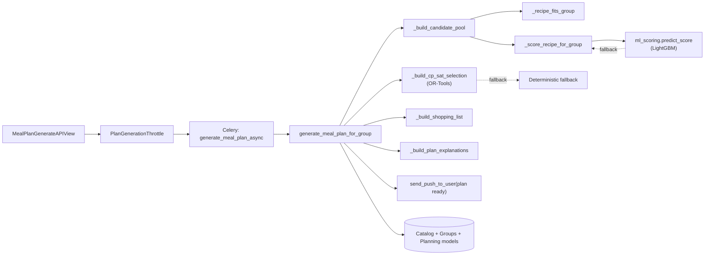

# C4 — Components: Planning service (Level 3)

## Notes

- `MealPlanGenerateAPIView` either runs synchronously (legacy / test mode) or
  enqueues a `PlanGenerationRun` with `Celery.delay`.
- `predict_score` consults a LightGBM model; on any failure falls through to
  the deterministic scorer so the planner is never blocked by ML stack issues.
- CP-SAT solver has a hard-coded 5s wall clock. If unsatisfiable or unavailable,
  the deterministic greedy is used.
- Plan generation success triggers an Expo push to the requesting user.
