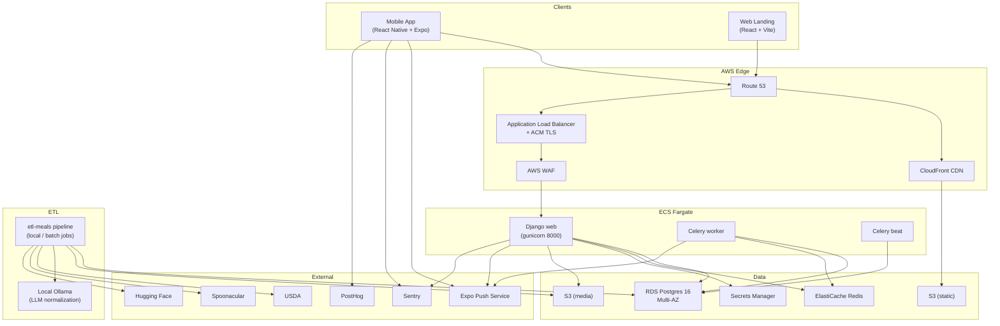

# C4 — Container View (Level 2)

## Notable containers

- **Mobile App** (`mobile/`) — primary client. React Native via Expo, ships
  through App Store and Play Market with EAS Build.
- **Django web** — REST + admin behind ALB. Async-friendly: long jobs handed
  to Celery via Redis.
- **Celery worker** — handles plan generation, push fan-out, recipe nutrition
  rebuild, ranker retraining.
- **Celery beat** — schedules periodic tasks (pantry expiration, ranker retrain,
  cost recalculation).
- **RDS Postgres 16** — multi-AZ, encrypted, daily backups, PITR.
- **ElastiCache Redis** — cache + Celery broker (different DBs).
- **S3 buckets** — recipe media (CloudFront-fronted) and Django static.
- **etl-meals** — separate Python project producing the import bundle and the
  ML training data; runs on demand or via scheduled Fargate one-off tasks.
