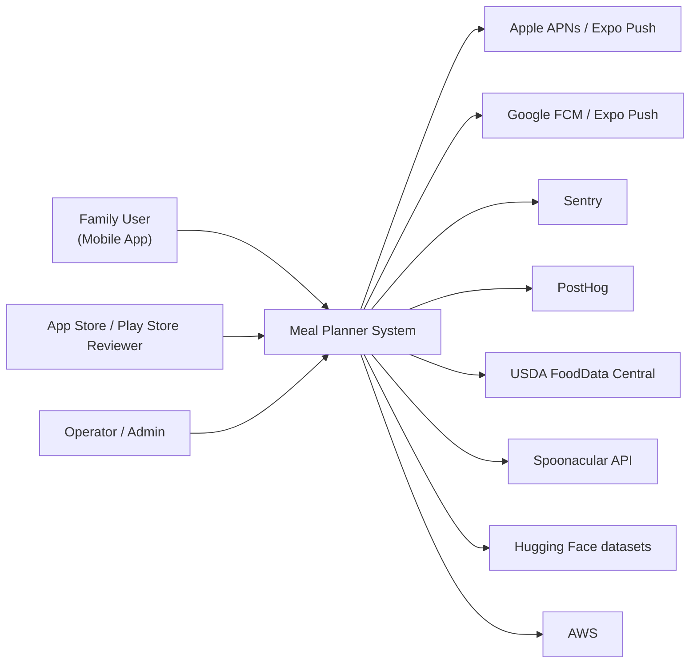

# C4 — System Context (Level 1)

## Actors

- **Family User** — uses the mobile app to manage households, generate plans,
  follow shopping lists, give feedback.
- **Reviewer** — Apple/Google reviewer with the demo account, validates the app
  for store approval.
- **Operator/Admin** — engineering and operations team, accesses Django admin
  via VPN/IP allowlist.

## External systems

- **Expo Push** — single endpoint for both APNs (iOS) and FCM (Android).
- **Sentry** — error and performance monitoring.
- **PostHog** — product analytics.
- **USDA FoodData Central** — canonical nutrition lookups during ETL.
- **Spoonacular / TheMealDB / HuggingFace** — recipe data sources.
- **AWS** — hosting (ECS, RDS, ElastiCache, S3, CloudFront, ALB).
